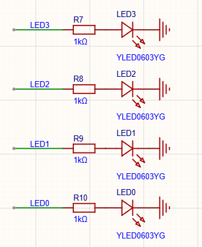
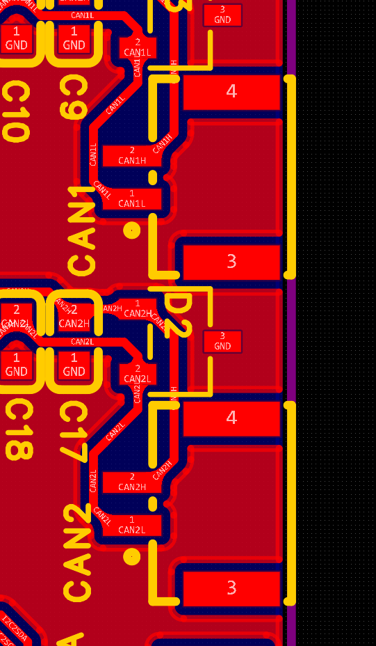

# WTR最终考核

本次考核作业为南工问天新生入队最终考核，解释权归南工问天所有

## 提交说明

本次作业需要提交到HITwtrobot@163.com

提交的内容有：工程所有代码+CubeMX ioc配置文件+成功实现任务视频

本次作业不设提交时间（当然是越早越好）

## 物料概述

1、STM32F407VET6主控板

2、DJIM3508+C620/DJIM2006+C610

3、CAN+电源分电板

由于物资数量有限需要前往战队验证代码

板上资源如图所示

## 任务

### 任务要求概述

- 如无特殊说明，速度单位采用rpm，位置单位采用deg，均为输出轴速度与输出轴位置，从电机输出轴看向电机本体（不加减速箱的电机屁股）顺时针为速度和位置正方向
- 字节顺序为小端序

- crc8的参数为：多项式0x07；初始值0x00；按位反转：false；异或值：0x00。(具体算法见附件中的crc.hpp)
- 电机控制与CAN启动代码可参考[Engine/BSP/DJI at V3.0 · SSC202/Engine](https://github.com/SSC202/Engine/tree/V3.0/BSP/DJI)

### 通信协议说明

下位机接收协议为： AA + BB + 控制模式 + int16_A + int16_B + CRC8

- 控制模式：0x00（速度模式），0x11（位置模式），0x22（预设动作模式）
- int16_A：
  - 速度模式：最大输出电流（力矩）
  - 位置模式：最大输出速度
- int16_B：（电机上电时刻为0度，顺时针为正）
  - 速度模式：控制速度
  - 位置模式：控制位置

预设动作模式时，控制速度与控制位置组成的4字节变量为预设动作id

战队提供的上位机会向串口发送相应协议的信息，需要下位机串口接收后解码并控制电机

下位机发送协议为： BB + AA + 反馈状态S + 反馈速度 + 反馈位置 + CRC8

- 反馈状态S：0xFF（电机出现异常（can总线收不到电机））
  - S & 0xF0：
    - 0xA0：速度模式
    - 0xB0：位置控制

  - S & 0x0F：
    - 0x0A：正在前往目标速度/位置/正在执行预设动作
    - 0x0F：到达目标速度/位置/完成目标预设动作

- 反馈速度：int16
- 反馈位置：int16

下位机需要通过串口向上位机发送信息反馈当前系统的状态

### 任务一 通过串口与上位机建立连接

主控板通过串口与上位机连接，要求：

- 发送和接收在稳定阶段都必须处于 DMA 模式；
- 自动丢弃错误帧和自动重连；
- 需要在 task 中处理收到的数据包；
- 上位机会向下位机定时发送数据包，要求检测上位机是否连接，上位机断开时系统进入急停状态（急停状态应当让整个系统处于安全状态，自行设计）；
- LED灯指示连接状态
  - 上位机连接成功，LED0 亮起；
  - 拔掉与板子连接的 MX 接口，LED0 熄灭；
  - 重新插上，LED0 亮起。

### 任务二 使用 PID 速度环和位置环分别控制 DJI M3508 /DJI M2006

主控板通过 CAN 与 C620 /C610电调建立连接，要求：

- 接收并解析 CAN 数据包，计算出减速后的转速和角度（转速单位 round/min（rpm）; 角度单位 deg; 角度零点为上电时位置）（可以先手动旋转电机观察反馈是否正确）
-  能通过 CAN 向 C620 /C610发送电流指令（相关指令格式和范围在手册中）。M3508 收到指令后能正常旋转。 （值不要给太大，不然电机容易飞起来）
-  电流指令绝对值最大应不超过8000（C620）/4000（C610），对应转矩电流10A/5A左右
- 实现位置式 PID 进行速度闭环，以 速度 rpm 为反馈输入。要求给定一个方波（第一秒 200rpm, 第二秒 0，第三秒 200rpm ...）能较好的跟随。尝试用手给转子提供阻力，电机也能良好跟随。 
- 在速度闭环的基础上通过串级 PID 构成位置闭环。输入为 角度 deg 
- （选做）尝试使用梯形曲线进行位置闭环

### 任务三 通过对串口信息解码控制电机

- 可以通过解码获得的速度/位置不同模式控制电机

- 可以完成预设动作模式

  - 0x00 00 00 00 

    60rpm（1s）->120rpm（1s）->180rpm（1s）->240rpm（2s）->300rpm（2s）->150rpm（1s）->0rpm（1s）

  - 0x11 11 11 11 

    0 -> 720° （停留3s）-> 360°（停留1s） ->0

  

  

  

  

  

